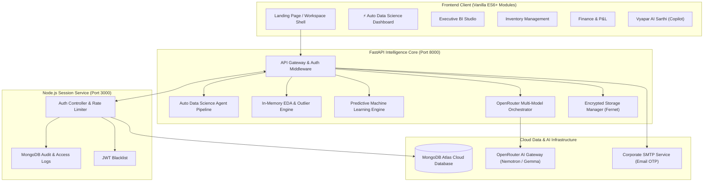

# Vyapar Verse — New Architecture Specification
## AI-Powered Business Operating System (VSS AI)
*Document Version: 2.0.0*

---

## 1. System Vision & Architecture Paradigm

Vyapar Verse is architected as an **intelligent, unified Business Operating System (BOS)** that consolidates business data ingestion, automated data science, executive business intelligence, operational inventory management, financial ledgers, and multi-model AI reasoning into one cohesive platform.

### Core Architectural Principle
> **"The user focuses on their business. VSS AI handles the technical complexity."**
> Normal users never see Python code, terminal logs, stack traces, or manual configuration prompts.

---

## 2. Component Specifications

### 2.1 The Automated AI Data Science Pipeline (Core Engine)
The pipeline requires only a file upload (.csv, .xlsx, .xls) and runs an end-to-end 8-stage automated workflow:
1. **Format & Encoding Ingestion**: Reads UTF-8/Latin-1 CSV or multi-worksheet Excel workbooks.
2. **Schema & Column Typing**: Detects numeric, categorical, date/time, text, identifier, and target columns.
3. **Automated Quality Assessment**: Calculates missing value percentages, duplicate row rates, and a 0–100 data health index.
4. **Safe Auto-Cleaning**: Reversible median/mode imputation, duplicate deduplication, and datetime standardisation with audit records.
5. **Statistical Profiling**: Calculates mean, median, standard deviation, skewness, min/max, and 1.5× IQR outlier boundaries.
6. **Dynamic Visualization Synthesis**: Creates distribution bar charts, trend lines, donut breakdowns, and correlation heatmaps.
7. **Predictive Modeling**: Automatically trains Random Forest / Ridge regression or classification models on high-variance target columns.
8. **Executive Insights Synthesis**: Generates plain-language business findings, executive warnings, and growth recommendations.

### 2.2 Security, Encryption & Privacy
- **Encrypted-at-Rest**: Files uploaded to `storage/users/<user_id>/uploads/<dataset_id>.enc` are encrypted with symmetric Fernet keys.
- **Tenant Isolation**: Every database record is linked to a specific `user_id` and `business_id`. Cross-tenant queries are blocked at the ORM query level.
- **AST Execution Sandbox**: Dynamic Python execution validates code through the `ast` module, forbidding unsafe imports (`os`, `sys`, `subprocess`, `eval`, `exec`).

### 2.3 Authentication & Email OTP System
- **Registration**: Full Name, Email, Password (min 8 chars), Confirm Password, Business Name.
- **Email OTP Generation**: 6-digit cryptographically secure random token, hashed via SHA256/bcrypt, stored with a 5-minute expiry timestamp.
- **Resend Safeguards**: 60-second cooldown period, maximum 5 attempts before token invalidation.
- **Account Verification**: Accounts remain unverified (`is_verified = False`) until correct OTP submission.
- **Password Recovery**: Secure OTP sent to registered email address for verified password reset.

---

## 3. Brand Identity & Design System

| Brand Element | Specification | Hex / Value |
|---|---|---|
| **Primary Navy** | Core structural UI, sidebar, headers | `#14233D` |
| **Dark Navy** | Deep dark mode background, active states | `#0C1729` |
| **Saffron Gold** | Primary call-to-actions, highlights, active nav | `#E99A3A` |
| **Warm Ivory** | Application canvas, background fill | `#F7F6F2` |
| **Slate Gray** | Subtitles, labels, secondary metadata | `#748197` |
| **Forest Green** | Positive metrics, profit, online status indicators | `#31856C` |
| **Primary Font** | Body text, UI controls, forms, tables | Inter |
| **Heading Font** | Hero headings, card titles, section headers | Manrope |
